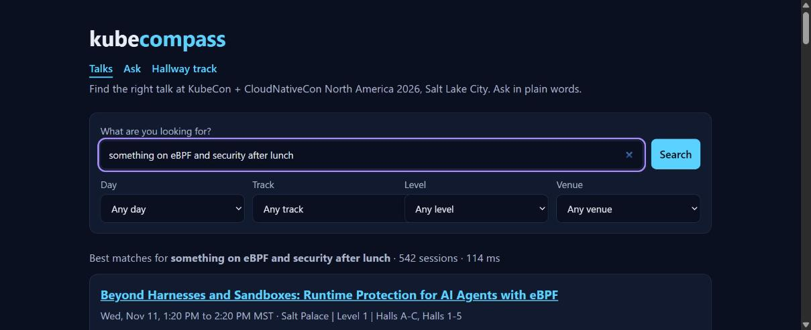
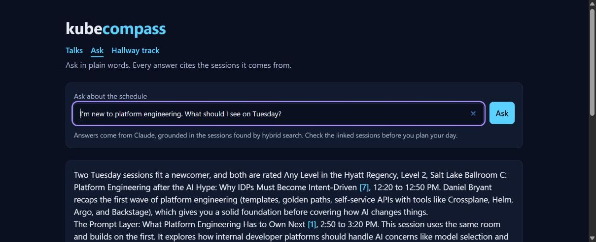
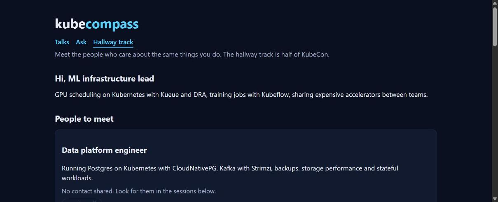
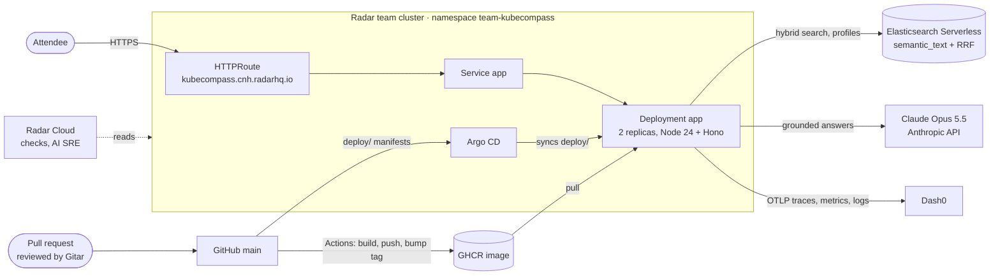

# kubecompass

Find the right talk and the right people at KubeCon + CloudNativeCon North America 2026.

**Live:** https://kubecompass.cnh.radarhq.io

Built solo by Cristian Cano at the [WeMakeDevs Cloud Native Hackathon](https://www.wemakedevs.org/hackathons/cnh), Salt Lake City, November 9, 2026.

## What it does

KubeCon has about 600 sessions and thousands of people. kubecompass helps an attendee decide where to be and who to talk to.

- **Talks**: hybrid search over the whole schedule. Keyword (BM25) and semantic retrieval are fused with reciprocal rank fusion, so "something on eBPF and security after lunch" finds runtime-security talks even when they never say "eBPF and security". Day, track, level and venue filters keep their counts as you narrow down.
- **Ask**: a question in plain words, answered by Claude from the sessions hybrid search retrieves. Every claim cites its session, and the citations link to the session cards.
- **Hallway track**: describe what you work on and get the five attendees whose interests match yours, plus the talks where you'll likely find them. Profiles are private links that only their owner can open or delete.

| Talks | Ask | Hallway track |
|---|---|---|
|  |  |  |

## Architecture

## How each tool is used

| Tool | What it does here |
|---|---|
| **Elasticsearch Serverless** | Data layer for the 600 sessions (`kubecon-sessions`) and the attendee profiles (`kubecon-attendees`), both with a `semantic_text` field. Every search is a `retriever` query that fuses a `multi_match` and a `semantic` retriever with RRF. Facets are filter aggregations inside a global aggregation, so each facet counts under every filter but its own. |
| **Claude (Anthropic API)** | Ask retrieves the eight best sessions with the same hybrid search, then Claude Opus 5.5 answers only from those numbered sources and cites them. Policy declines retry on the server-side fallback, and a per-pod rate limit caps paid calls. |
| **Dash0** | Receives OpenTelemetry traces, metrics and logs from every pod. One trace shows the request, the search, the Elasticsearch call and the Claude call with its token counts. Agent0 investigated the service in production (see below). |
| **Radar Cloud** | Runs the cluster UI, best-practice Checks, GitOps sync and its MCP server, which this project used to apply the Argo CD Application, sync, restart and read logs and events. Its AI SRE investigated the Deployment (see below). |
| **Gitar** | Reviewed every pull request. Its findings were fixed before merging, among them light-mode contrast, facets hiding their own options, a private GHCR image the cluster couldn't pull, profile ids leaking into traces, a rate limit that a bad value disabled, and overlapping readiness pings. |
| **Argo CD and GitHub Actions** | A push to `main` builds the image, pushes it to GHCR, checks the cluster can pull it anonymously, and commits the new tag. Argo CD syncs it. |

## AI SRE in practice

Updating the `app-credentials` Secret by hand in the afternoon went wrong twice: first a malformed URL, then truncated keys. The rollout stalled, but the old pods kept serving. Two AI investigations then looked at it independently:

- **Radar's AI SRE** reconstructed the incident from cluster state alone (329 readiness 503s, 14 back-offs, two Secret updates, the restart that fixed it) and flagged readiness-probe timeouts on the healthy pods. Asked what to change, it recommended answering `/readyz` from a background check instead of calling Elasticsearch on every probe.
- **Dash0 Agent0** confirmed from telemetry that no user request failed, measured Elasticsearch pings of up to 10 s behind `/readyz`, showed that 73 to 93% of an Ask request is the Claude call, and noticed laptop runs mixed into production data and a blind spot: crash-looping pods die before exporting anything.

Their findings became pull requests: #8 makes a bad Secret value obvious (trimmed values, URL validation, readiness and exporter failures in the logs), and #9 moves readiness to a cached background check and tags local runs. Radar Checks for the namespace went from four findings on the app (auto-mounted service account token, no PodDisruptionBudget, no topology spread, both replicas on one node) to none.

## Setup

1. Copy `.env.example` to `.env` and fill in the values. `.env` is git-ignored. Only the two Elasticsearch values are required; Dash0 and Anthropic are optional and their features turn off without them.
2. `npm install`.
3. `npm run ingest` downloads and parses the KubeCon schedule into `kubecon-sessions`. `npm run setup-attendees -- --seed` creates `kubecon-attendees` with ten sample profiles, labeled as samples in the UI.
4. `npm run dev` for the local server, or `npm test` for the test suite (typecheck with `npm run typecheck`).

## Deploy

Deploys are GitOps, following the [cnh-starter](https://github.com/skyhook-io/cnh-starter) layout:

1. A push to `main` runs `.github/workflows/deploy.yaml`, which builds the `Dockerfile` into `ghcr.io/cristiancc123/kubecompass:<short-sha>` and commits that tag to `deploy/kustomization.yaml`.
2. Argo CD, inside the team's Radar cluster, syncs `deploy/` into namespace `team-kubecompass`. The Argo CD Application in `argocd/application.yaml` is applied once through Radar's MCP server.
3. The app is served at https://kubecompass.cnh.radarhq.io.

The image must be public, because the cluster has no registry credentials. GHCR creates a new package as private, so after the first build open the package on GitHub, then Package settings > Change visibility > Public, and re-run the workflow. The workflow checks anonymous pulls and refuses to point the manifests at an image the cluster can't fetch.

Credentials never go in git. Create the Secret `app-credentials` in namespace `team-kubecompass` by hand (for example in Radar's resource editor) with the keys `elasticsearch-url`, `elasticsearch-api-key` and, optionally, `dash0-auth-token` for telemetry and `anthropic-api-key` for the Ask assistant. The Deployment reads them through `secretKeyRef`.

To try the image locally: `docker build -t kubecompass . && docker run --rm -p 8080:8080 --env-file .env kubecompass`.

## Observability

With `DASH0_OTLP_ENDPOINT` and `DASH0_AUTH_TOKEN` set, the app exports traces, metrics and logs to Dash0 over OTLP/HTTP (`src/telemetry.ts`). Without them telemetry is off and nothing else changes.

- Every request is a span from the Hono middleware. A search adds a `search sessions` span with the mode, filters and totals, and the Elasticsearch client nests its own span under it.
- `kubecompass.search.duration` is a histogram split by mode and outcome.
- Errors are OpenTelemetry log records that carry the trace id, so Dash0 links a log line to its request.
- In Kubernetes, `OTEL_RESOURCE_ATTRIBUTES` adds the pod, namespace, node and cluster to everything the app sends.
- What people type stays out: spans keep the URL path without the query string, and record query lengths and counts, never the text.

## Accessibility

Every page works without JavaScript and is checked against WCAG 2.2 AA.

- `test/a11y.test.ts` runs axe-core on every page state (results, empty, errors, answers, forms, profiles) in CI, with a self-check that a known violation is caught.
- Color contrast, which axe can't measure without a browser, was checked by hand for both color schemes: text at least 5.6:1, form control borders at least 3.5:1, focus ring at least 6.3:1.
- A skip link moves keyboard focus to each page's main region, every control has a visible label and focus ring, and no field steals focus on load.
- Pages reflow at 390 px wide without horizontal scrolling.

## AI disclosure

This project was built with the help of AI coding assistants, mainly Claude Code (Anthropic), which wrote most of the code under the author's direction. Every change went through a pull request that Gitar reviewed, and the author reviewed and merged it. The Ask feature calls Claude at runtime, and Radar's AI SRE and Dash0 Agent0 were used to investigate the running system.

## License

MIT
